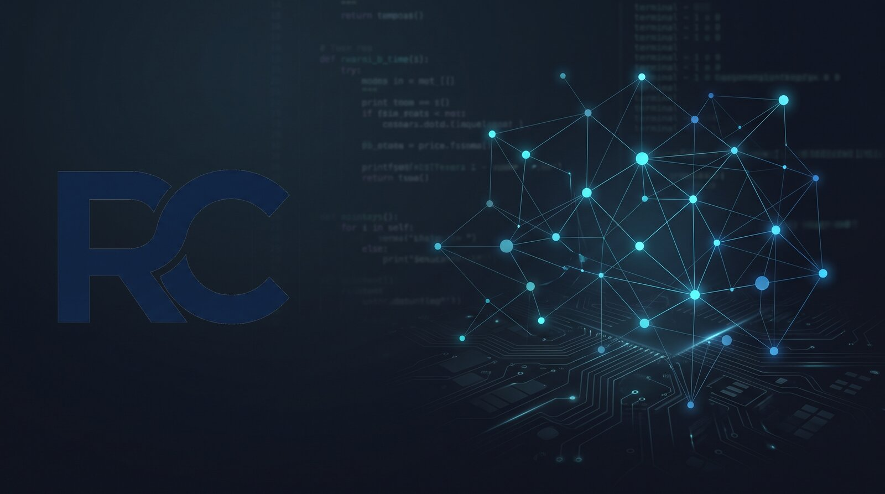

  

 

<h1 align="center">Renan Croffi</h1>

  <strong>Back-end Python • SQL • Ciência de Dados • Machine Learning</strong>

Do banco de dados à API: construindo software com base sólida em dados.

---

## Sobre

### Desenvolvedor Back-end Python · Cientista de Dados

Base quantitativa em **Física e Engenharia Elétrica**, cursando **Tecnologia em Desenvolvimento de Software Multiplataforma** (FATEC Olímpia/SP) — foco atual em **desenvolvimento back-end com Python**: modelagem de banco de dados, APIs, testes automatizados e fluxo completo de Git/GitHub (issue → branch → PR).

Em paralelo, sigo a formação em **Ciência de Dados** (Anhanguera), aplicando a mesma base de Python, SQL e modelagem de dados a extração, tratamento e modelagem preditiva — interesse no mercado financeiro.

---

### 🚀 Projetos em destaque

#### ⭐ [Secure Vault](https://github.com/ReCroffi/secure-vault)
Gerenciador de senhas com criptografia ponta a ponta: senha mestra nunca persistida (hash Argon2id), chave de criptografia derivada em memória, credenciais cifradas com AES antes de tocar o banco, geração de senha com CSPRNG (`secrets`) e TUI interativa.

---

**⚙️ [E-commerce Behavior Analysis](https://github.com/ReCroffi/ecommerce-behavior-analysis)**
Pipeline de ML ponta a ponta sobre 42M+ eventos de clickstream: propensão de compra com XGBoost + Optuna, segmentação RFM, explicabilidade via SHAP e modelo servido por um endpoint FastAPI.

**🔬 [MML from Scratch](https://github.com/ReCroffi/mml-from-scratch)**
PCA e regressão linear implementados do zero (autovalores/autovetores, gradiente descendente e equações normais), validados contra o scikit-learn.

**📉 [Bank Churn Prediction](https://github.com/ReCroffi/bank-churn-prediction)**
Modelo de classificação que separou clientes de Alto Risco (53% de churn) de Baixo Risco (4%) — diferença de 13× — com dashboard executivo.

---

### 🎓 Formação & Certificações

- Cursando, em simultâneo, **Tecnologia em Desenvolvimento de Software Multiplataforma** (FATEC Olímpia/SP) e **Ciência de Dados** (Anhanguera)
- **Especialização** - Mathematics for Machine Learning · Imperial College London / Coursera — [verificar](https://coursera.org/verify/specialization/YHCO1L7BLOGR)
- **Introduction to Back-End Development** · Meta / Coursera — [verificar](https://coursera.org/verify/WX92VEYNJ03Y)
- Passagem por **Engenharia Elétrica** e **Física** (cursados, sem conclusão)
- **Inglês C2** — EF SET (80/100)

---

### 🏫 Faculdade

- [**fatec-dsm**](https://github.com/ReCroffi/fatec-dsm) — atividades e exercícios do curso, organizados por semestre e matéria
- [**projeto-1-semestre**](https://github.com/ReCroffi/projeto-1-semestre) — projeto integrador de extensão, em grupo

---

### 📫 Contato
- **LinkedIn:** [linkedin.com/in/renancroffi](https://linkedin.com/in/renancroffi)
- **E-mail:** renancroffi@gmail.com